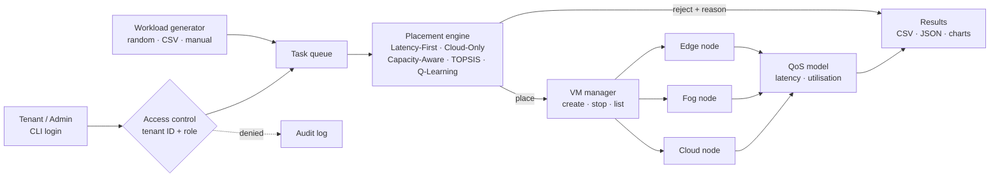

# EdgeFogSim — Spec & Delivery Plan

ARM 305 Mini Project: a locally runnable Python simulator that accepts computing tasks, places each on an Edge, Fog or Cloud node, simulates resource use with VM records, enforces tenant isolation, and reports QoS results.

This document is the source of truth. Every feature below has an ID (`F#`) and acceptance criteria (`AC`) that become pytest cases. A phase is done when its ACs pass and its manual check works.

---

## 1. Feature list

| ID | Feature | What it does | Rubric area (marks) |
|----|---------|--------------|---------------------|
| F1 | Node model | Edge, Fog and Cloud nodes loaded from `config/nodes.json`: CPU cores, memory (GB), base network latency (ms), processing speed factor, live CPU/memory utilisation | Node & workload (20) |
| F2 | Workload generator | Seeded random generator (≥10 tasks), load from CSV/JSON, or add a task by hand. Task = id, tenant, CPU, memory, latency sensitivity (low/medium/high), work units | Node & workload (20) |
| F3 | Placement engine | Pluggable policies: **Latency-First** and **Cloud-Only** (baselines), **Capacity-Aware** (the required rule-based algorithm, filter-then-score), **TOPSIS** (multi-criteria ranking), and optionally **Q-Learning** (reinforcement learning). Every decision records a human-readable reason | Placement algorithm (20) |
| F4 | Overload handling | If the preferred node lacks capacity, try the next suitable tier (offload); if nothing fits or the deadline cannot be met, reject with a reason | Placement algorithm (20) |
| F5 | Latency / QoS model | Simulated latency = network latency + processing time × congestion factor; deadline per sensitivity; success/failure per task | QoS (15) |
| F6 | VM manager | Each placed task gets a VM record (VM ID, host node, allocated CPU/RAM, tenant, status). Create, stop, list. Stopping frees node capacity | VM & access control (15) |
| F7 | Tenant access control | Log in as a tenant (tenant ID + role, no real passwords). Tenants see only their own tasks/VMs; cross-tenant reads raise `AccessDenied` and are written to an audit log | VM & access control (15) |
| F8 | Metrics & results | Per-task results table, per-node utilisation, total/successful/failed/rejected counts, average and p95 latency, deadline-hit rate. Saved to CSV + JSON | QoS (15) |
| F9 | Charts | matplotlib: placements per tier by policy, node utilisation, latency distribution, before/after comparison | QoS (15) |
| F10 | Interactive CLI | Menu-driven app covering every feature, for the live demo | Demonstration (10) |
| F11 | Experiment runner | One command runs the 4 required experiments and writes setup / expected / actual / evidence to `results/experiments.md` | QoS (15), Testing (10) |
| F12 | Tests & docs | pytest suite mapped to ACs, README, architecture diagram, report, slides, ZIP builder | Testing & docs (10), Architecture (10) |
| F13 | User-supplied parameters | Every generated or default value (nodes, tasks, generator ranges, seed, deadlines, policy thresholds, tenants, experiment setups) comes from an editable config file and can be overridden from the CLI flags or the menu. User values always win; bad values fail with the exact file, row and field | All areas: lets the team run its own scenarios |

### Features that set it apart (beyond the minimum)

1. **Explainable placement.** Each decision prints *why* it happened, e.g. `T07 → fog-1: high sensitivity, edge-1 at 92% CPU, offloaded to fog (est. 24 ms ≤ 25 ms deadline)`. This makes the viva easy to answer.
2. **Offload chain, not just reject.** The overload experiment shows both outcomes: a task offloaded to the next tier, and a task rejected when no tier can meet its deadline.
3. **VM lifecycle frees capacity.** Stopping a VM releases resources, and a task rejected earlier can then be placed. This shows the virtualisation concept working, not just stored.
4. **Live what-if.** Admin changes a node's capacity or latency from the menu and re-runs the same workload. A side-by-side diff table and chart are generated automatically.
5. **Audit log.** Denied cross-tenant access attempts are timestamped in `results/audit.log`. This is the security evidence.
6. **Reproducible runs.** A fixed seed means the same workload every time, so policy comparisons are fair and the demo can't go off-script.
7. **One-command evidence pack.** `python run_experiments.py` regenerates every table, chart and experiment write-up. `python make_zip.py` builds the submission ZIP and checks every required item is in it.

---

## 2. Architecture



### Module layout

```
edgefogsim/
  config.py        # load defaults → files → flags → menu edits, validate (F13)
  models.py        # Node, Task, VM, PlacementResult dataclasses        (F1, F2, F6)
  workload.py      # generator, CSV/JSON load, manual entry             (F2)
  policies.py      # LatencyFirst, CloudOnly, CapacityAware, Topsis     (F3, F4)
  qlearning.py     # QLearningPolicy + trainer (optional, Phase 7)      (F3)
  qos.py           # latency + deadline model                           (F5)
  vm_manager.py    # VM create/stop, resource accounting                (F6)
  security.py      # Session, AccessDenied, audit log                   (F7)
  simulator.py     # runs a workload through a policy, collects results (F3–F8)
  metrics.py       # pandas aggregation, CSV/JSON export                (F8)
  charts.py        # matplotlib figures                                 (F9)
  cli.py           # interactive menu                                   (F10)
config/
  nodes.json        # node definitions
  tenants.json      # tenant IDs and roles
  simulation.json   # generator ranges, seed, deadlines, policy thresholds
  experiments.json  # workload + node changes for E1–E4
examples/
  tasks_sample.csv  # template for a user-supplied workload
run_experiments.py # experiment runner                                  (F11)
make_zip.py        # submission packager                                (F12)
tests/             # pytest, one file per module
```

---

## 3. Simulation model and algorithm spec

### Nodes (default `config/nodes.json`)

| Node | Tier | CPU cores | Memory GB | Base latency ms | Speed factor |
|------|------|-----------|-----------|-----------------|--------------|
| edge-1 | Edge | 4 | 8 | 5 | 0.6 |
| fog-1 | Fog | 16 | 32 | 20 | 1.0 |
| cloud-1 | Cloud | 128 | 512 | 80 | 2.0 |

Edge is close but small and slow; Cloud is far but huge and fast. That tension is what makes placement interesting.

### Tasks

`id, tenant_id, cpu_cores, memory_gb, sensitivity ∈ {low, medium, high}, work_units`

Deadlines: **high ≤ 25 ms, medium ≤ 100 ms, low ≤ 400 ms**.

### Latency model

```
processing_ms   = work_units / speed_factor
congestion      = 1 / (1 − min(cpu_util_after_placement, 0.95))
simulated_ms    = base_latency_ms + processing_ms × congestion
success         = placed AND simulated_ms ≤ deadline(sensitivity)
```

The congestion term grows sharply as a node fills up (a simple M/M/1-style queueing approximation). That gives the "before/after capacity change" experiment visible results.

### Policies at a glance

Five policies share one interface, `choose(task, nodes) -> Decision(node | None, reason)`, so the simulator, metrics and experiments treat them the same way. They cover the algorithm families used in the edge/fog literature (see "Why these policies" below).

| Policy | `--policy` | Family | Role |
|--------|-----------|--------|------|
| A. Latency-First | `latency` | Greedy rule | Baseline: nearest node with space |
| B. Cloud-Only | `cloud` | Greedy rule | Baseline: everything to the cloud (iFogSim's standard comparison) |
| C. Capacity-Aware | `capacity` | Filter-then-score rules | **The required rule-based algorithm** |
| D. TOPSIS | `topsis` | Multi-criteria decision making | Research-style extension |
| E. Q-Learning | `qlearn` | Reinforcement learning | Optional stretch (Phase 7) |

All policies share the same **filters** (a node is *feasible* only if it has the free CPU and memory and, where the policy checks deadlines, meets the deadline). They differ in how they **choose** among feasible nodes. Every decision records a reason listing why each rejected node failed.

### Policy A — Latency-First (baseline)

1. Sort all nodes by base latency (edge → fog → cloud).
2. Place on the first node with enough free CPU and memory.
3. If none fits → reject.

It ignores sensitivity, utilisation and deadlines, so it fills Edge first even with tasks that could have gone to the Cloud.

### Policy B — Cloud-Only (baseline)

Place every task on the cloud node with the most free CPU; reject if no cloud node fits. Shows what happens without Edge/Fog at all: urgent tasks miss deadlines because of the cloud's network delay.

### Policy C — Capacity-Aware (main rule-based algorithm)

Modelled on how production schedulers such as Kubernetes work: **filter out** nodes that can't take the task, **score** the rest, pick the highest score.

1. **Tier preference by sensitivity** (configurable): high → `[edge, fog, cloud]`, medium → `[fog, edge, cloud]`, low → `[cloud, fog, edge]`.
2. **Capacity filter:** the node has free CPU and memory for the task, **and** utilisation after placement ≤ `headroom` (default 85%).
3. **Deadline filter:** estimated `simulated_ms` ≤ the task's deadline.
4. **Score** each node that passes:
   ```
   score = w_tier  × tier_rank      (1st preference 1.0, 2nd 0.5, 3rd 0.0)
         + w_slack × deadline_slack (deadline − est_ms) / deadline
         + w_free  × free_after     1 − cpu_util_after_placement
   ```
   Default weights `w_tier 0.5, w_slack 0.3, w_free 0.2` (configurable). Ties → lower estimated latency, then node ID.
5. Place on the highest score. If its tier isn't the task's first preference, record it as an **offload**, with the reason.
6. If nothing passes, relax `headroom` to 100% and retry once (soft overload, configurable on/off).
7. Still nothing → **reject**, recording which filter failed on each node.

Compared with a plain "first that fits" rule, scoring lets it prefer a less-loaded Fog node over an almost-full Edge node when both meet the deadline, and it scales to several nodes per tier.

### Policy D — TOPSIS (multi-criteria)

TOPSIS ranks options by how close each is to an ideal option and how far from the worst one. Papers on fog node selection commonly pair it with AHP-derived weights; we take the weights from config instead.

1. Apply the capacity and deadline filters from Policy C (no headroom limit).
2. Build a decision matrix, one row per feasible node, with criteria: estimated latency (cost), CPU free after placement (benefit), memory free after placement (benefit).
3. Vector-normalise each column and multiply by its weight (default latency 0.5, CPU 0.3, memory 0.2).
4. Ideal = best value per column, anti-ideal = worst. Closeness = distance to anti-ideal ÷ (distance to ideal + distance to anti-ideal).
5. Place on the highest closeness; reason lists each node's closeness. One feasible node → choose it; none → reject.

### Policy E — Q-Learning (optional stretch)

A table-based reinforcement learner in plain Python (no deep-learning libraries).

- **State:** task sensitivity × utilisation band of each tier (low < 50%, medium 50–85%, high > 85%) → 3 × 3 × 3 × 3 = 81 states.
- **Action:** a tier (edge, fog, cloud); within the tier, the node with the most free CPU.
- **Reward:** +1 if the task meets its deadline, −1 if late, −2 if the chosen tier has no capacity (task rejected).
- **Training:** ε-greedy over many generated workloads (different seeds from the evaluation workload); learning rate α, discount γ, ε and episode count come from config. The learned Q-table is saved to `results/q_table.json` and reloaded for evaluation with ε = 0.
- **Reason text:** the Q-values for each action in that state, so the choice is still explainable.

### Why these policies

The surveys group fog/edge scheduling methods into heuristic, metaheuristic, machine-learning and deterministic families, with metaheuristics (~38%) and heuristics (~30%) the most common and deep RL the fastest-growing ([Hosseinzadeh et al., IEEE Access 2023](https://uwe-repository.worktribe.com/output/10835811/task-scheduling-mechanisms-for-fog-computing-a-systematic-survey); [Alsadie, PeerJ CS 2024](https://peerj.com/articles/cs-2128)). Our choices and their sources:

- **Baselines A and B** mirror the cloud-only and edge-ward placement that iFogSim studies compare against ([LAMP](https://researchgate.net/profile/Mahboobe-Rezaei/publication/333768532_LAMP_A_Hybrid_Fog-Cloud_Latency-Aware_Module_Placement_Algorithm_for_IoT_Applications/links/5d42effaa6fdcc370a7407f0/LAMP-A-Hybrid-Fog-Cloud-Latency-Aware-Module-Placement-Algorithm-for-IoT-Applications.pdf); [YAFS](https://arxiv.org/pdf/1902.01091)).
- **C** follows the filter-and-score design of the Kubernetes scheduler ([NodeResources plugins](https://pkg.go.dev/k8s.io/kubernetes@v1.22.6/pkg/scheduler/framework/plugins/noderesources)) and satisfies the brief's required rule-based algorithm.
- **D** follows AHP + TOPSIS fog-node selection work ([JART 2025](https://jart.icat.unam.mx/index.php/jart/article/view/2653); [IJITDM 2024](https://ideas.repec.org/a/wsi/ijitdm/v23y2024i06ns0219622023500712.html); [Baranwal et al. 2020](https://www.springerprofessional.de/en/qoe-aware-iot-application-placement-in-fog-computing-using-modif/18255230)).
- **E** is a simplified version of DQN-based offloading ([Tang & Wong, IEEE TMC 2020](https://arxiv.org/pdf/2005.02459); [DRL-OS](https://www.ncbi.nlm.nih.gov/pmc/articles/PMC9740101/)): the same state–action–reward idea with a table instead of a neural network.
- **Not chosen:** genetic algorithms and PSO ([DATA](https://repository.sharif.edu/resource/509947/-/&from=search&&query=hosseini-monazzah--a&field=authorOther&count=20&execute=true); [PSO-SA](https://biblio.cerist.dz/show/ar/00000000000000622306000000)) optimise a whole batch at once, which doesn't fit our one-task-at-a-time placement, adds randomness to results and is harder to explain per decision. Listed as future work.

### VM lifecycle

`PENDING → RUNNING` on placement (resources allocated) → `STOPPED` on stop (resources freed). VM IDs look like `vm-0001`. A rejected task creates no VM.

### Security model

- `Session(tenant_id, role)` where role is `tenant` or `admin`. Login is by choosing a tenant ID from `config/tenants.json`. No passwords are stored.
- Every read of tasks, VMs or results goes through `security.authorize(session, record)`.
- Tenant → own records only. Admin → everything (needed to edit nodes and run experiments).
- A violation raises `AccessDenied` and appends `timestamp, actor, target_tenant, resource, DENIED` to `results/audit.log`.

---

## 3a. Configuration and user-supplied parameters (F13)

**Rule: nothing the simulator generates is hard-coded.** Every number in §3 is a *default* in a config file. The user can replace any of it.

### Precedence (lowest → highest)

1. Built-in defaults in `config.py` (used only if a file is missing)
2. Files in `config/`
3. A config file passed in: `--config my_scenario.json` (any subset of keys; the rest fall back)
4. Command-line flags: `--seed`, `--tasks N | path.csv`, `--nodes path.json`, `--policy`, `--deadline high=40`, `--headroom 0.9`
5. Menu edits during a session, optionally saved with "Save current settings as…"

The resolved settings are printed at start-up and written into every results folder as `settings_used.json`, so each run can be reproduced exactly.

### What is configurable

| Area | File | Keys |
|------|------|------|
| Nodes | `nodes.json` | list of `{id, tier, cpu_cores, memory_gb, base_latency_ms, speed_factor}`; any number of nodes per tier |
| Tasks | `--tasks file.csv / .json` or menu | `id, tenant_id, cpu_cores, memory_gb, sensitivity, work_units` (id optional, auto-numbered if blank) |
| Generator | `simulation.json` → `generator` | `count`, `seed`, `cpu_range`, `memory_range`, `work_range`, `sensitivity_mix` (e.g. `{high:0.4, medium:0.3, low:0.3}`), `tenant_mix` |
| QoS | `simulation.json` → `qos` | `deadlines_ms` per sensitivity, `congestion_cap` (0.95) |
| Policy | `simulation.json` → `policy` | `headroom` (0.85), `tier_preference` per sensitivity, `soft_overload_retry` (true), `capacity_weights` (`tier` 0.5, `slack` 0.3, `free` 0.2), `topsis_weights` (`latency` 0.5, `cpu` 0.3, `memory` 0.2) |
| Q-learning | `simulation.json` → `qlearning` | `alpha` (0.1), `gamma` (0.9), `epsilon` (0.2), `episodes` (500), `train_seed` (1000) |
| Tenants | `tenants.json` | list of `{tenant_id, role}` |
| Experiments | `experiments.json` | per experiment: workload source, seed, node overrides, policies to compare |

### Validation

Every input is checked on load. On error the program stops with the file, row/key and reason, e.g. `my_tasks.csv row 4, cpu_cores: must be > 0 (got -2)`. It never silently guesses or clamps.

---

## 4. User flow

```
python -m edgefogsim
 │
 ├─ Login: pick tenant (hospital-a / hospital-b / admin)
 │
 └─ Main menu
     1. View nodes (capacity, utilisation, latency)
     2. Workload → generate N tasks (seed) | load CSV | add task manually
     3. Choose policy (Latency-First / Cloud-Only / Capacity-Aware / TOPSIS / Q-Learning)
     4. Run placement → live decision log with reasons
     5. View results table (own tasks only, or all if admin)
     6. VMs → list | create | stop (frees capacity)
     7. View another tenant's task by ID   → ACCESS DENIED + audit entry
     8. Export results (CSV + JSON) and charts (PNG)
     9. [admin] Edit node capacity/latency → re-run → diff
    10. [admin] Run all experiments
    11. Switch user / Exit
```

Non-interactive commands, for scripting and experiments:

```bash
python -m edgefogsim run --policy capacity --tasks 20 --seed 42
python run_experiments.py
python make_zip.py
```

---

## 5. What a successful demo looks like (≈5 minutes)

| # | Step | What the audience sees |
|---|------|------------------------|
| 1 | Launch, log in as `hospital-a` | Node table: Edge/Fog/Cloud at 0% utilisation |
| 2 | Generate 12 tasks (seed 42) | Task table with CPU, memory and sensitivity, mixed across two tenants |
| 3 | Run **Latency-First** | Edge fills up, high-sensitivity tasks that arrive late get pushed to Cloud and miss their deadlines |
| 4 | Reset, run **Capacity-Aware** | Decision log with reasons and offloads; higher success rate |
| 5 | Show results + chart | Side-by-side table (success %, avg/p95 latency, utilisation) and bar chart |
| 6 | Overload: submit a heavy high-sensitivity task | Offloaded to Fog with a reason; then an impossible one is rejected with a reason |
| 7 | Stop a VM, resubmit the rejected task | Capacity freed, task now placed |
| 8 | Try to view a `hospital-b` task | `ACCESS DENIED`, then show the audit log line |
| 9 | Admin: double Edge capacity, re-run | Before/after diff table and chart |
| 10 | Close on `results/` folder | CSV, JSON, PNGs and `experiments.md` all generated |

Success criteria: no crashes, every number on screen traceable to a CSV row, every decision explained, and the same output every time (fixed seed).

---

## 6. Required experiments (F11)

| Exp | Setup | Expected outcome | Evidence |
|-----|-------|------------------|----------|
| E1 Policy comparison | Same 20-task workload (seed 42) through every policy (Latency-First, Cloud-Only, Capacity-Aware, TOPSIS, and Q-Learning if built) | Capacity-Aware and TOPSIS have a higher deadline-hit rate and more even utilisation than both baselines; Cloud-Only misses most high-sensitivity deadlines | `e1_policy_comparison.csv`, `e1_placement.png`, `e1_latency.png` |
| E2 Overload | Edge pre-loaded to 90%, then a burst of high-sensitivity tasks | Early tasks offloaded to Fog; tasks that can't meet the deadline are rejected with a reason; nothing over-allocates | `e2_overload.csv`, decision log |
| E3 Unauthorised access | `hospital-b` requests a `hospital-a` task and VM | `AccessDenied` raised, nothing returned, audit entry written; admin read succeeds | `e3_access.txt`, `audit.log` excerpt |
| E4 Capacity/latency change | Baseline run, then Edge CPU ×2 and Cloud latency 80 → 150 ms, same workload | More tasks stay on Edge; low-sensitivity Cloud tasks get slower but still pass | `e4_before_after.csv`, `e4_diff.png` |

Each one is written to `results/experiments.md` with setup, expected, actual and an evidence link.

---

## 7. Acceptance criteria (become pytest cases)

| AC | Feature | Given / When / Then |
|----|---------|---------------------|
| AC1 | F1 | Given the default config, when nodes load, then there is exactly one node each of edge, fog and cloud, with utilisation 0 |
| AC2 | F2 | Given seed 42 and N=12, when generated twice, then both workloads are identical and every task has CPU, memory and sensitivity |
| AC3 | F2 | Given a malformed CSV row (negative CPU), when loaded, then it raises a validation error naming the row |
| AC4 | F3 | Given a high-sensitivity task and empty nodes, when Capacity-Aware runs, then it lands on edge |
| AC5 | F3 | Given a low-sensitivity task, when Capacity-Aware runs, then it lands on cloud |
| AC6 | F4 | Given edge at 90% CPU, when a high-sensitivity task arrives, then it is offloaded to fog and the reason mentions edge capacity |
| AC7 | F4 | Given a task larger than any free capacity, then it is rejected, no VM is created and no node is over-allocated |
| AC8 | F5 | Given higher utilisation on a node, then simulated latency for the same task is strictly higher |
| AC9 | F6 | When a VM is stopped, then node free CPU/memory increases by exactly the VM's allocation and status = STOPPED |
| AC10 | F6 | Stopping an already-stopped VM is a no-op with a warning, not a double free |
| AC11 | F7 | Given a session for hospital-b, when it reads a hospital-a task, then `AccessDenied` is raised and one audit line is appended |
| AC12 | F7 | Given an admin session, all tenants' records are readable |
| AC13 | F8 | total = placed + rejected; success + failed = total; exported CSV row count = total |
| AC14 | F9 | Running the charts step creates non-empty PNGs at the expected paths |
| AC15 | F11 | `run_experiments.py` exits 0 and writes all 4 sections to `experiments.md` |
| AC16 | F13 | Given a `--config` file that sets only `qos.deadlines_ms.high = 40`, then high deadline is 40 and every other setting equals the default |
| AC17 | F13 | Given a config file value and a CLI flag for the same key, the flag wins; `settings_used.json` records the final value |
| AC18 | F13 | Given a user nodes file with 2 edge nodes and no fog node, the simulator loads it and placement still follows the tier preference (skipping the missing tier) |
| AC19 | F13 | Given an invalid value in any config or task file, loading fails with a message naming the file, row/key and field |
| AC20 | F3 | Given an empty cluster, Cloud-Only places every fitting task on cloud and every high-sensitivity task misses its deadline with the default node latencies |
| AC21 | F3 | Given two feasible nodes in the same tier, Capacity-Aware picks the one with the higher score (more free capacity), and the reason lists both scores |
| AC22 | F3 | Given a hand-computed 3-node decision matrix, TOPSIS closeness values match the expected values to 3 decimal places |
| AC23 | F3 | Changing `capacity_weights` or `topsis_weights` in a config file changes the choice for a constructed tie-break case, with no code change |
| AC24 | F3 | (Phase 7) After training with a fixed `train_seed`, Q-Learning's deadline-hit rate on the evaluation workload is ≥ Latency-First's, and two training runs with the same seed give identical Q-tables |

---

## 8. Framework trade-off analysis

| Concern | Options considered | Choice | Why |
|---------|--------------------|--------|-----|
| Core data model | dataclasses · pandas DataFrames · SQLite | **dataclasses** | Clear typed objects for nodes, tasks and VMs make the code easy to read and explain in the viva. Mutating per-task state in a DataFrame is awkward, and SQLite is explicitly not required |
| Results & aggregation | built-in lists/dicts · **pandas** | **pandas** | groupby, describe and CSV/JSON export in one line each; the brief suggests it. Used only at the reporting boundary, not in the simulation loop |
| Charts | **matplotlib** · seaborn · plotly | **matplotlib** | Required by the brief, saves static PNGs for the report and slides, no browser needed. Seaborn adds little; plotly charts are interactive, but static images go in the report anyway |
| User interface | plain `input()` menu · **rich** + menu · Textual TUI · Streamlit | **Plain menu + `rich` for tables/colour** | Runs in any terminal, works offline at the demo, and coloured tables make decisions and ACCESS DENIED stand out. Streamlit looks nicer but adds a server, rerun-on-click state headaches and more to debug live. Textual is overkill. If `rich` isn't installed, fall back to plain text |
| CLI commands | **argparse** · click · typer | **argparse** | Standard library, enough for 3 subcommands, nothing extra to install |
| Config | **JSON** · YAML · TOML | **JSON** | Standard library read *and* write (admin edits nodes and saves them). YAML needs PyYAML; `tomllib` is read-only |
| Persistence | **CSV + JSON files** · SQLite | **CSV + JSON** | What the brief asks for, opens in Excel for the report, easy to diff between runs |
| Security | tenant ID only · tenant ID + role · hashed PIN (hashlib) | **Tenant ID + role, central `authorize()`, audit log** | Meets "tenant can't see another's records" with no real credentials (the brief forbids storing them). One choke-point function is easy to test and to explain |
| Randomness | `random` · numpy | **`random.Random(seed)`** | Reproducible, no extra dependency |
| Placement algorithms | Greedy rules · filter-and-score · multi-criteria (SAW, TOPSIS, AHP) · metaheuristics (GA, PSO) · RL (tabular Q, DQN) | **Rules for baselines, filter-and-score for the required algorithm, TOPSIS as the research extension, tabular Q-learning as a stretch** | Covers the main families in the literature while keeping every decision explainable. GA/PSO optimise whole batches (doesn't fit per-task placement) and add run-to-run variance. DQN needs PyTorch and training time; a Q-table gives the same idea in ~100 lines of plain Python |
| Tests | **pytest** · unittest | **pytest** | Shorter tests, fixtures for a fresh cluster, readable failure output |
| Architecture diagram | **Mermaid** · draw.io · matplotlib-drawn | **Mermaid in docs + exported PNG** | Lives in the repo as text (diffable in PRs), renders on GitHub; PNG exported once for the report and slides |
| Report | **python-docx** · Markdown→PDF (pandoc) · Google Docs | **.docx, exported to PDF** | Editable by the whole team, no LaTeX/pandoc install, matches the usual submission format |
| Slides | **python-pptx** · Google Slides · Canva | **.pptx** | Editable, offline, charts embedded straight from `results/` |
| Packaging | **`make_zip.py` (zipfile)** · manual zip | **Script** | Checks every required deliverable is present before zipping, which avoids the late-penalty scramble |

**Python version:** target 3.10+ (developed on 3.14) so every teammate can run it.
**`requirements.txt`:** `pandas`, `matplotlib`, `rich`, `pytest`. Report and slide tooling (`python-docx`, `python-pptx`) goes in `requirements-docs.txt`, so the core app stays lean.

---

## 9. Delivery phases — one branch and one PR each

Each phase ends with a runnable app you can test by hand, plus green tests. Branch off `main`, open a PR, review, merge, then start the next phase from the updated `main`.

| Phase | Branch | Scope | Your manual test at the end | ACs |
|-------|--------|-------|-----------------------------|-----|
| 0 | `chore/project-setup` | Package skeleton, `requirements.txt`, pytest config, all four `config/*.json` default files, `examples/tasks_sample.csv`, README stub, this spec | `pip install -r requirements.txt && pytest` passes (smoke test); `python -m edgefogsim --help` prints usage | — |
| 1 | `feature/nodes-and-workload` | F1, F2, F13 config loader + overrides, a minimal CLI (login, view nodes, generate/load/add tasks) | Log in, see 3 nodes, generate 12 tasks with seed 42 twice and get the same table, load `examples/tasks_sample.csv`, add a task by hand, swap in your own nodes file and change the seed with a flag | AC1–3, AC16–19 |
| 2 | `feature/placement-engine` | F3 (policies A–D), F4, F5, simulator loop, decision log in the CLI | Run all four policies on the same workload and read the reasons; push Edge to overload and see an offload and a reject; change a weight in config and see a different choice | AC4–8, AC20–23 |
| 3 | `feature/vm-and-tenancy` | F6, F7, audit log, tenant-scoped views | List VMs, stop one and watch capacity return, log in as hospital-b and get denied on a hospital-a task, check `audit.log` | AC9–12 |
| 4 | `feature/results-and-charts` | F8, F9, export, admin node editing + before/after diff | Export, open the CSV in Excel, view the PNGs, change Edge capacity and see the diff | AC13–14 |
| 5 | `feature/experiments` | F11 runner, `experiments.md`, polished demo script | `python run_experiments.py` regenerates everything; read `experiments.md` | AC15 |
| 6 | `docs/report-slides-package` | README final, architecture PNG, 5–8 page report, 5–7 slides, screenshots, `make_zip.py` | Follow the README on a clean venv; open the report and slides; the ZIP contains every deliverable | — |
| 7 *(optional)* | `feature/learning-policy` | Policy E (Q-Learning), trainer, `q_table.json`, added to E1 and the report | `python -m edgefogsim train --episodes 500`, then run E1 and see Q-Learning in the comparison table and chart | AC24 |

Phase 7 is a stretch goal. It starts only after Phase 6 is merged, so the required deliverables are never at risk; if there's time it can land before the report is finalised.

**PR checklist (every phase):** tests green · README run instructions updated · ACs ticked in the PR description · manual-test steps listed so the reviewer can repeat them · no generated `results/` files committed except the final evidence pack in Phase 6.

---

## 10. Limitations (for the report)

- Discrete, sequential placement; no real time, task duration or network jitter.
- Latency model is analytical (M/M/1-style approximation), not measured.
- No migration of running VMs; a placement is final until the VM is stopped.
- Placement is per task (online); batch optimisers such as GA/PSO are left as future work.
- TOPSIS can suffer rank reversal when the set of feasible nodes changes (noted by Baranwal et al.).
- Q-Learning uses a coarse 81-state table; it learns tier choice, not node choice, and is only as good as its training workloads.
- Tenant identity is trusted from login; there's no authentication, by design (the brief forbids real credentials).
